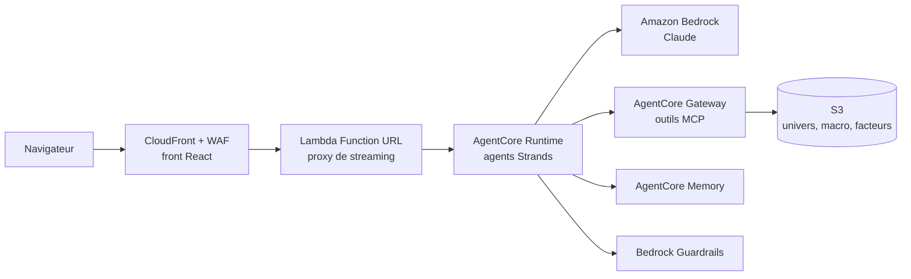

# MonPort · Datathon 2026

**Équipe 20** : Maxime Pierre, Ioannis Nikoloudis, Jorge Velez, Jérémy Langevin.
**Client** : BNCD (Banque Nationale Courtage Direct).

MonPort est un outil agentique qui **propose** des portefeuilles à un client de courtage direct. Il n'en impose jamais un : c'est le client qui choisit. Les propositions sont éducatives et ne constituent pas une recommandation.

## Le produit en bref

1. **Questionnaire.** Le client répond à 7 questions (âge, montant, ajouts prévus, objectif, horizon, réaction à une baisse de 20 %, aisance). Il indique ensuite ses préférences : véhicules (FNB, titres individuels ou les deux), classes d'actifs, régions, thématiques et, s'il est à l'aise, facteurs (qualité, momentum, value…).
2. **Vérification par Pépite.** Pépite, la mascotte, est l'analyste. Elle relit les réponses et juge si le profil de risque et les préférences sont cohérents. Elle peut expliquer ses calculs dans un carnet.
3. **Construction.** Pépite écrit 3 profils de contraintes. 3 gestionnaires travaillent en parallèle, des agents Risque relisent chaque portefeuille, puis un juge tranche :
   - profil **cohérent** : 3 variantes (prudente, fidèle, audacieuse) se font concurrence et le juge garde la meilleure ;
   - profil **incohérent** : le client voit 3 portefeuilles, « Tes contraintes » et deux mélanges 80/20 entre son profil et ses préférences.
4. **Tableau de bord.** Trois niveaux de lecture (Débutant, Intermédiaire, Avancé) : répartition, backtest, VaR et ES, projection sur 10 ans, exposition aux facteurs, mises en garde avec leurs preuves. Un chat avec Pépite permet d'ajuster le portefeuille.

**Principe central : les agents proposent, le code garantit.** Les poids, les rendements, les risques et la conformité aux limites sont calculés par du code (Markowitz sur tout l'univers, Ledoit-Wolf, backtest), jamais par un modèle. Les agents expliquent, comparent et choisissent. Les limites réglementaires restent dures : aucune ligne au-delà de 40 %, pas de levier.

## Architecture



- **Frontend** (`frontend/`) : React 19, Vite, TypeScript, Tailwind 4, Recharts, Zustand. Le front ne calcule aucun chiffre du tableau de bord. Sans backend, il bascule en **mode démo** sur des données d'exemple.
- **Backend** (`backend/`) : pipeline multi-agents `invest_agents` (Strands Agents sur Amazon Bedrock). Un seul point d'entrée, `POST /invocations`, qui répond en flux SSE. Pépite tourne sous Claude Sonnet 5.5, les gestionnaires, agents Risque et juge sous Claude Opus 5.5.
- **AWS** (us-east-1) : AgentCore Runtime, Gateway et Memory, Bedrock Guardrails, Lambda, S3, CloudFront et WAF, traces dans CloudWatch. Détails et justification de chaque service : [docs/documentation-technique.md](docs/documentation-technique.md).

## Structure du dépôt

| Dossier | Contenu |
|---|---|
| `frontend/` | Application React : parcours, carnet de Pépite, tableau de bord, chat |
| `backend/` | Agents, outils métier, optimiseur, backtest, serveur MCP (`mcp_server/`), tests |
| `data-prep/` | Construction de l'univers (`build_universe.py`, 801 actifs), notebooks macro et facteurs |
| `deploy/` | Scripts AWS CLI idempotents et identifiants des ressources (`deploy/state/`) |
| `docs/` | Documentation technique, architecture AWS, audit des paramètres |
| `assets/` | Poses de Pépite (`mascot/`) et intro vidéo (`intro/`) |

## Guide d'installation

### Prérequis

- **Python 3.11 ou plus récent** (3.12 recommandé en local ; le runtime AgentCore utilise 3.13).
- **Node.js 20 ou plus récent** et npm.
- **Git**.
- Pour faire tourner les agents : **AWS CLI v2** et des identifiants AWS valides, avec accès aux modèles Claude sur Amazon Bedrock en `us-east-1`. Sans AWS, seul le front en mode démo fonctionne.

Toutes les commandes partent de la racine du dépôt, sauf mention contraire.

### 1. Récupérer le code

```bash
git clone https://github.com/maximepierregit/Datathon_pf_2026.git datathon-pf-2026
cd datathon-pf-2026
```

### 2. Front seul, en mode démo (sans AWS)

```bash
npm --prefix frontend ci
npm --prefix frontend run dev
```

Ouvre http://localhost:5173. Comme aucun backend ne répond, une bannière signale le mode démo et l'interface tourne sur des données d'exemple. C'est suffisant pour parcourir l'interface.

### 3. Backend en local

**Environnement Python**

```bash
python3.12 -m venv backend/.venv          # ou toute version ≥ 3.11 (python3 --version pour vérifier)
backend/.venv/bin/pip install -e 'backend[dev]'
```

Si le système n'a pas Python 3.11 ou plus, [uv](https://docs.astral.sh/uv/) l'installe :

```bash
uv venv --python 3.12 backend/.venv
uv pip install --python backend/.venv/bin/python -e 'backend[dev]'
```

**Identifiants AWS**

```bash
aws sts get-caller-identity     # doit afficher le compte; sinon, configure tes identifiants
```

Sur le compte Workshop Studio de l'événement, les identifiants expirent. Recolle le bloc `export AWS_ACCESS_KEY_ID=… AWS_SECRET_ACCESS_KEY=… AWS_SESSION_TOKEN=…` de la page de l'événement quand la commande échoue.

**Réglages**

```bash
cp backend/.env.example backend/.env
```

Le backend ne lit pas `.env` tout seul : il faut charger les variables dans le terminal (étape suivante). Les modèles, la région et la source du dataset y sont réglés.

**Dataset** (au choix)

- *Depuis S3* (compte de l'équipe, droit `s3:GetObject` sur le bucket) : dans `backend/.env`, remplace la ligne `MONPORT_UNIVERSE_PARQUET_URI` par :
  ```bash
  MONPORT_UNIVERSE_PARQUET_URI=s3://monport-datasets-381491955506/universe/universe.parquet
  MONPORT_MACRO_PARQUET_URI=s3://monport-datasets-381491955506/macro/macro_long_z.parquet
  MONPORT_FACTORS_PARQUET_URI=s3://monport-datasets-381491955506/factors/factor_scores.parquet
  ```
- *Reconstruit en local* (Wikipédia et yfinance, quelques minutes, cache dans `data-prep/data/raw/`) :
  ```bash
  backend/.venv/bin/pip install -r data-prep/requirements.txt
  backend/.venv/bin/python data-prep/build_universe.py      # écrit backend/data/universe.parquet
  ```
  Sans table macro ni scores de facteurs, les agents continuent sans contexte macro et les préférences de facteurs sont ignorées.

**Lancer le serveur** (depuis `backend/`, car le chemin local du dataset est relatif à ce dossier)

```bash
cd backend
set -a && source .env && set +a
PORT=8091 .venv/bin/python main.py
```

Vérification, dans un autre terminal :

```bash
curl -s localhost:8091/ping          # {"status":"Healthy",...}
```

Le port 8091 est celui qu'attend le proxy de Vite. AgentCore utilise 8080 en production.

### 4. Front branché sur le backend local

Avec le serveur de l'étape 3 en marche :

```bash
npm --prefix frontend run dev
```

Vite redirige `/api` vers `localhost:8091`. Un parcours complet prend 2 à 4 minutes, car il appelle Bedrock.

Pour tester le pipeline sans le front :

```bash
cd backend
.venv/bin/python scripts/run_local.py                    # vérification puis construction
.venv/bin/python scripts/run_local.py --check-only       # vérification seule
```

### 5. Vérifier l'installation

```bash
(cd backend && .venv/bin/python -m pytest -q)            # sans Bedrock; certains tests lisent backend/data/universe.parquet
npm --prefix frontend run build
npm --prefix frontend run lint
```

### Dépannage

| Symptôme | Cause probable |
|---|---|
| `ExpiredToken`, `UnrecognizedClientException` | Identifiants AWS expirés : relance `aws sts get-caller-identity` et recolle le bloc `export` |
| `AccessDeniedException` sur Bedrock | Accès aux modèles Claude non activé dans la console Bedrock, ou mauvaise région (`AWS_REGION=us-east-1`) |
| `Parquet introuvable : data/universe.parquet` | Serveur lancé hors de `backend/`, ou dataset absent (étape 3) |
| Bannière « démo » alors que le backend tourne | Backend sur un autre port que 8091, ou erreur au démarrage (voir son terminal) |
| `Address already in use` | Port occupé : change `PORT` (et la cible du proxy dans `frontend/vite.config.ts`) |

## Déploiement sur AWS

Chaque service a son script AWS CLI idempotent dans `deploy/`. Ordre pour un compte vide : `deploy-gateway.sh`, `deploy-guardrail.sh`, `deploy-memory.sh`, `deploy-agentcore.sh`, `deploy-proxy.sh`, `deploy-cloudfront.sh`. Pour republier seulement le front : `FRONT_ONLY=1 ./deploy/deploy-cloudfront.sh`. `deploy/teardown.sh` supprime tout après l'événement.

Les détails (rôles IAM, vérifications, repli sur l'EC2) sont dans [docs/documentation-technique.md §9](docs/documentation-technique.md#9-déploiement-et-exploitation) et [backend/README.md](backend/README.md#déploiement-sur-aws).

## Documentation

- [docs/documentation-technique.md](docs/documentation-technique.md) : architecture AWS, choix par service, sécurité, coûts, données, déploiement.
- [docs/architecture-workflow.md](docs/architecture-workflow.md) : schéma du workflow et des événements SSE.
- [backend/README.md](backend/README.md) : démarrage du backend, contrats d'entrée et de sortie, structure du code.
- [data-prep/UNIVERSE.md](data-prep/UNIVERSE.md) et [data-prep/FACTORS.md](data-prep/FACTORS.md) : construction de l'univers et des scores de facteurs.
- [CLAUDE.md](CLAUDE.md) : référence détaillée du produit et des règles de calcul.
