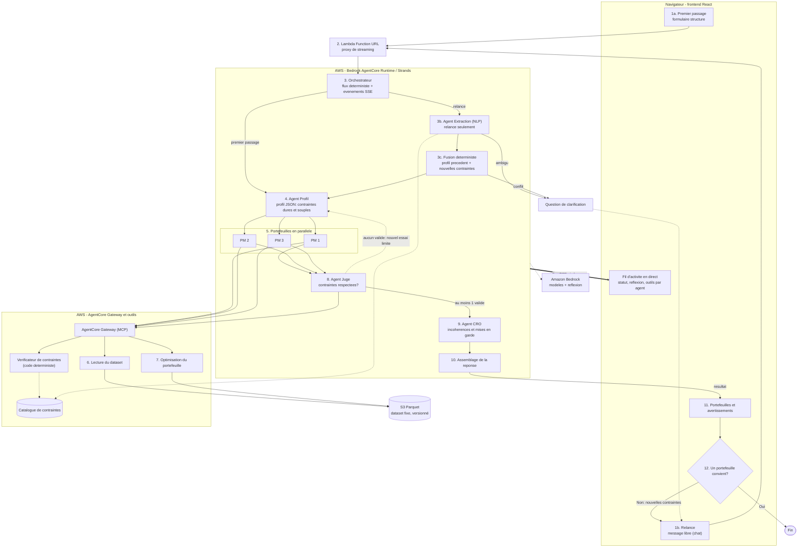

# Architecture - Workflow du profil d'investisseur (v3)

Dataset fixe, sans couche edge ni API de validation, avec streaming de la réflexion vers le frontend.

## Diagramme



## Simplifications

- Retirés: WAF, Cognito, CloudFront, Lambda de validation, EventBridge et ingestion Glue.
- Le formulaire est déjà structuré et arrive directement à l'agent Profil (étape 4).
- Une seule Lambda mince reste: le proxy de streaming (étape 2). Un navigateur ne peut pas signer (SigV4) un appel vers AgentCore Runtime sans identifiants AWS. Pour la compétition, Function URL sans authentification, CORS restreint au frontend, à supprimer après l'événement.
- Le dataset fixe est publié dans S3 (`s3://monport-datasets-381491955506/universe/universe.parquet`, bucket privé, chiffré et versionné) par `data-prep/build_universe.py --upload`. Le runtime le télécharge une fois par démarrage à froid (28 Mo) et le garde en mémoire: l'optimiseur a besoin de toute la matrice de rendements, donc Athena n'apporterait que de la latence. Le rôle d'exécution n'a que `s3:GetObject` sur `universe/*` (politique `MonPortDatasetRead`).

## Relance conversationnelle

La relance repart de l'agent Profil (étape 4), précédée de deux étapes:

1. **3b. Agent Extraction (NLP)**: transforme le message libre en contraintes structurées, validées contre le catalogue de contraintes (généré à partir des colonnes du dataset).
2. **3c. Fusion déterministe**: fusionne avec le profil précédent et détecte les conflits.

Si le texte est ambigu, non reconnu ou en conflit, le système pose une question de clarification dans le chat. Le frontend garde le contexte (profil, portefeuilles, contraintes) et le renvoie à chaque relance.

## Streaming de la réflexion

Chemin: agents Strands, orchestrateur, AgentCore Runtime (SSE), proxy Lambda, navigateur.

1. **Réflexion du modèle**: activer le thinking dans le `BedrockModel` (`additional_request_fields={"thinking": {"type": "enabled", "budget_tokens": 2000}}`). Paramètres à vérifier selon le modèle Claude retenu.
2. **Capture**: `agent.stream_async(...)` ou `callback_handler` pour chaque agent. Les événements vont dans une `asyncio.Queue` partagée, car les 3 PM tournent en parallèle.
3. **Format unique des événements**:

```json
{"step": 5, "agent": "PM 2", "type": "thinking", "text": "..."}
{"step": 5, "agent": "PM 2", "type": "tool", "name": "optimiser_portefeuille", "status": "start"}
{"step": 8, "agent": "Juge", "type": "status", "text": "Vérification des contraintes"}
{"type": "result", "data": {}}
{"type": "error", "message": "..."}
```

4. **Émission SSE**: le point d'entrée AgentCore (`@app.entrypoint`) est un générateur asynchrone; chaque `yield` devient un événement `text/event-stream`.
5. **Proxy**: Lambda Function URL avec `InvokeMode: RESPONSE_STREAM`, qui appelle `invoke_agent_runtime` et relaie les chunks sans les bufferiser. Le streaming de réponse est natif en Node.js; en Python il faut Lambda Web Adapter (à confirmer dans la documentation actuelle).
6. **Frontend**: `fetch` + `response.body.getReader()` (pas `EventSource`, GET seulement). Un réducteur groupe les événements par agent pour le fil d'activité.

### Recommandations d'affichage

- Une ligne de statut par agent, avec la réflexion brute dans un panneau repliable.
- Événements `status` émis par le code à chaque changement d'étape, fiables même sans réflexion du modèle.
- Heartbeat toutes les quelques secondes pendant les longs appels d'outil.
- Erreurs transmises dans le flux (`type: error`), car les en-têtes HTTP sont déjà envoyés.
