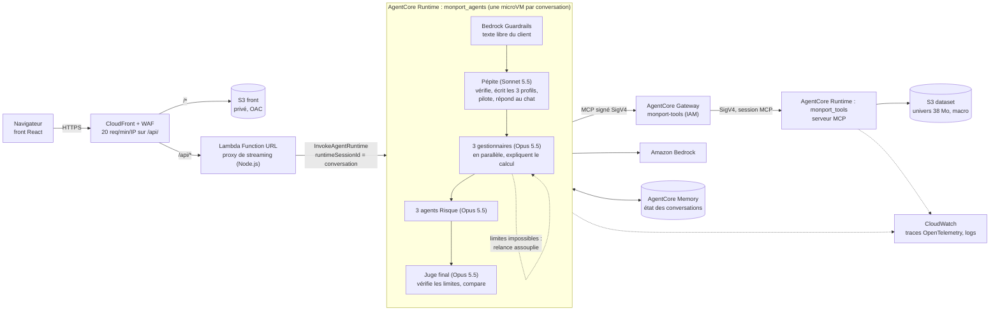

# Architecture MonPort (v4) : agents sur AgentCore, outils derrière AgentCore Gateway

Tout tourne sur des services gérés AWS. Aucun serveur à administrer : l'EC2 historique ne sert plus que de repli pour le front.

## Schéma

## Pourquoi chaque service

| Besoin | Service | Raison |
|---|---|---|
| Héberger des agents qui travaillent 2 à 4 min et gardent une conversation | **AgentCore Runtime** | Une microVM isolée par conversation (`runtimeSessionId`), jusqu'à 8 h, mise à l'échelle automatique. Les agents gardent leur mémoire : Pépite peut demander « pourquoi » au gestionnaire plus tard. |
| Appeler AgentCore depuis un navigateur | **Lambda Function URL** (`RESPONSE_STREAM`) | Le navigateur ne peut pas signer en SigV4. La Lambda signe avec son rôle et relaie le flux SSE sans tampon (battement de cœur toutes les 15 s). Elle valide le mode, la taille et l'identifiant de conversation. Concurrence plafonnée à 8. |
| Des outils financiers partagés et gouvernés | **AgentCore Gateway + serveur MCP sur Runtime** | Un catalogue MCP unique protégé par IAM, réutilisable par d'autres agents. Le serveur MCP garde le dataset en mémoire : l'optimiseur a besoin de toute la matrice de rendements. Une Lambda la rechargerait à chaque démarrage à froid. Avec les sessions MCP, un appel prend 0,5 s au lieu de 18 s. |
| Le chat libre d'un client de courtage | **Bedrock Guardrails** (palier STANDARD, multilingue) | Bloque les injections de prompt, les insultes, les demandes d'infraction financière (délit d'initié, blanchiment) et les numéros sensibles (NAS, carte). Seul le texte du client est évalué, jamais le JSON des agents. |
| Une conversation qui survit au recyclage d'une microVM | **AgentCore Memory** (court terme, 7 jours) | L'état (questionnaire, profils, portefeuilles, verdicts, gagnant) est enregistré après chaque étape. Une microVM neuve le restaure, et Pépite répond avec le contexte. |
| Voir ce que font les 10 agents | **AgentCore Observability** (ADOT, CloudWatch Transaction Search) | Une trace par requête : Pépite, les 3 gestionnaires en parallèle, chaque appel d'outil par la Gateway, les jetons et la latence (console CloudWatch, GenAI Observability). |
| Servir le front en HTTPS et protéger l'API publique | **S3 + CloudFront + WAF** | HTTPS, URL stable, en-têtes de sécurité. Le WAF limite `/api/` à 20 requêtes par minute et par IP, ce qui protège la facture Bedrock d'une API sans authentification. |
| Le dataset | **S3** (privé, chiffré, versionné) | Publié par `data-prep/build_universe.py --upload`. Lecture seule pour le runtime des outils. |

Écartés : Athena (l'optimiseur a besoin de toute la matrice en mémoire), Cognito (aucun compte client dans ce prototype), une IaC complète (les scripts `deploy/` sont idempotents et suffisent pour l'événement).

## Principe : les agents proposent, le code garantit

- Les poids, les indicateurs et la conformité viennent de l'optimiseur et du vérificateur (`tool_core.py`), jamais du texte d'un modèle.
- Les outils vus par le modèle ne prennent que ses choix (titres, filtres). Le code ajoute lui-même les contraintes du client, l'objectif et le plafond de volatilité avant l'appel MCP. Le modèle ne peut donc ni changer ni contourner une contrainte.
- Si la Gateway échoue, l'outil tourne dans le processus (`gateway.run`) : le parcours du client ne casse pas.

## Parcours

1. **Vérification** (`monport_check`) : Pépite lit le questionnaire, appelle les outils de risque et de cohérence, puis rend son verdict. Le serveur d'outils est préchauffé pendant ce temps.
2. **Construction** (`monport`) : Pépite écrit les 3 profils de contraintes. Pour chacun des 3 gestionnaires, en parallèle, le code calcule le portefeuille (Markowitz global). Si les limites dures sont impossibles à tenir, il le recalcule aussitôt avec des limites assouplies, devenues des préférences, et avertit le client. Le gestionnaire explique ensuite le résultat (`get_portfolio`, macro par la Gateway), et son agent Risque le relit. Le juge vérifie les limites et compare, sans demander de reconstruction. Profil cohérent : un gagnant. Profil incohérent : 3 propositions (mélanges 80/20 calculés par le code).
3. **Chat** (`monport_chat`) : le guardrail filtre le message, puis Pépite répond. Elle peut interroger ses agents ou relancer une construction.

## Événements (SSE)

`frontend/src/types.ts` (`PipelineEvent`) : `check`, `agent_status`, `pepite`, `universe`, `rerun`, `warning`, `portfolios`, `error`, `done`. Le front lit le flux avec `fetch` et `response.body.getReader()`. L'en-tête `X-Session-Id` (une conversation par vérification) devient le `runtimeSessionId` d'AgentCore. Si le backend ne répond pas, un bandeau « Mode démonstration » signale que le script d'exemple a pris le relais.

## Déploiement

Scripts idempotents en AWS CLI. Les identifiants des ressources sont dans `deploy/state/`, versionné pour toute l'équipe.

| Script | Crée ou met à jour |
|---|---|
| `deploy/deploy-gateway.sh` | runtime MCP `monport_tools`, Gateway `monport-tools`, cible, rôles |
| `deploy/deploy-guardrail.sh` | guardrail `monport-pepite` et une nouvelle version |
| `deploy/deploy-memory.sh` | mémoire `monport_conversations` |
| `deploy/deploy-agentcore.sh` | runtime `monport_agents` et son rôle d'exécution (lit les identifiants ci-dessus) |
| `deploy/deploy-proxy.sh` | Lambda `monport-proxy`, Function URL, CORS |
| `deploy/deploy-cloudfront.sh` | bucket du front, CloudFront, WAF (`FRONT_ONLY=1` : republie le build) |
| `deploy/deploy.sh` | front sur l'EC2 (repli), branché sur la Function URL |
| `deploy/teardown.sh` | supprime tout après l'événement |

Tests de fumée : `backend/scripts/smoke_runtime.py [--url …] [--restore]` et `backend/scripts/smoke_gateway.py`.
