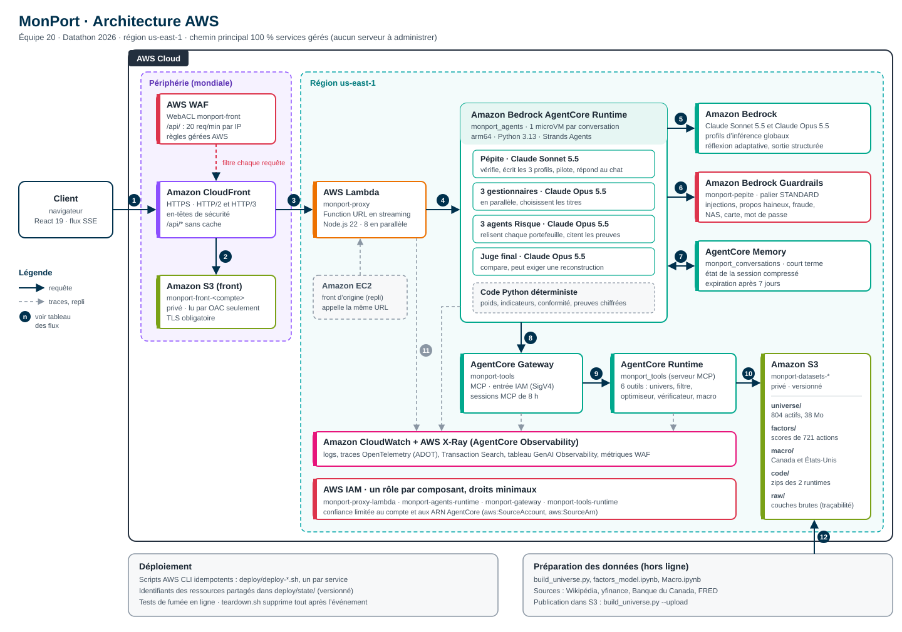
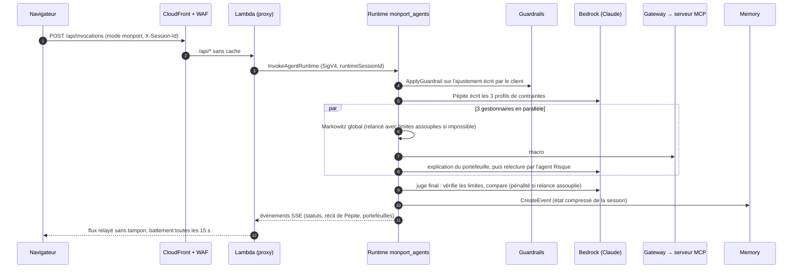

# MonPort : documentation technique et architecture AWS

**Équipe 20** : Maxime Pierre, Ioannis Nikoloudis, Jorge Velez, Jérémy Langevin
**Client** : BNCD (Banque Nationale Courtage Direct) · **Datathon 2026** · remise du 15 novembre 2026

---

## 1. En bref

MonPort propose des portefeuilles à un client de courtage direct, sans jamais en imposer un. Le client répond à un questionnaire et indique ses préférences. Une équipe de 8 agents d'IA (Pépite l'analyste, 3 gestionnaires, 3 agents Risque, un juge final) construit, critique et compare des portefeuilles réels sur un univers de 804 placements. Le client choisit, puis pose ses questions à Pépite dans un chat.

Deux décisions structurent l'architecture :

1. **Les agents proposent, le code garantit.** Les modèles choisissent des titres et rédigent les explications. Les poids, les indicateurs et la conformité aux contraintes viennent toujours du code (optimiseur, vérificateur). Un modèle ne peut ni inventer un chiffre ni contourner une contrainte du client.
2. **Uniquement des services gérés AWS sur le chemin principal.** Aucun serveur à administrer, mise à l'échelle automatique, paiement à l'usage. Chaque service répond à un besoin précis, décrit à la section 4.

| Couche | Services AWS |
|---|---|
| Diffusion et protection | Amazon CloudFront, AWS WAF, Amazon S3 (front) |
| Entrée de l'API | AWS Lambda (Function URL en streaming) |
| Agents | Amazon Bedrock AgentCore Runtime, Amazon Bedrock (Claude Sonnet 5.5 et Opus 5.5) |
| Outils financiers | AgentCore Gateway (MCP), AgentCore Runtime (serveur MCP) |
| Sécurité du dialogue | Amazon Bedrock Guardrails |
| État des conversations | AgentCore Memory |
| Données | Amazon S3 (jeu de données privé et versionné) |
| Observabilité | Amazon CloudWatch, AWS X-Ray (AgentCore Observability) |
| Accès | AWS IAM (un rôle par composant) |

---

## 2. Carte de l'architecture AWS

*Fichiers : `docs/architecture-aws.svg` (vectoriel) et `docs/architecture-aws.png` (image).*

### Flux numérotés

| # | De → vers | Protocole et contrôle |
|---|---|---|
| 1 | Navigateur → CloudFront | HTTPS (HTTP/2 et HTTP/3). Le WAF filtre chaque requête avant CloudFront. |
| 2 | CloudFront → S3 (front) | `/*` : fichiers statiques du front React. Le bucket est privé et n'accepte que cette distribution (OAC, signature SigV4). |
| 3 | CloudFront → Lambda | `/api/*` : sans cache, vers la Function URL du proxy. Même domaine que le front, donc pas de CORS pour le navigateur. |
| 4 | Lambda → AgentCore Runtime | `InvokeAgentRuntime` signé SigV4 par le rôle de la Lambda. `runtimeSessionId` = identifiant de la conversation. Réponse relayée en flux SSE. |
| 5 | Runtime → Bedrock | `InvokeModel` en streaming, profils d'inférence globaux des modèles Claude. |
| 6 | Runtime → Guardrails | `ApplyGuardrail` sur le texte libre du client seulement (ajustement et messages du chat). |
| 7 | Runtime ↔ Memory | `CreateEvent` après chaque étape, `ListEvents` pour restaurer une conversation sur une microVM neuve. |
| 8 | Runtime → Gateway | Protocole MCP, signé SigV4 (autorisation entrante IAM). |
| 9 | Gateway → Runtime des outils | MCP signé avec le rôle de la Gateway. La session MCP garde la même microVM, dont le jeu de données est déjà en mémoire. |
| 10 | Runtime des outils → S3 | `GetObject` en lecture seule sur `universe/`, `factors/` et `macro/`. |
| 11 | Tous → CloudWatch / X-Ray | Logs, traces OpenTelemetry (ADOT) des 2 runtimes et de la Gateway, traçage actif de la Lambda, métriques du WAF. |
| 12 | Préparation des données → S3 | Publication hors ligne du jeu de données (`build_universe.py --upload`). |

### Une construction de portefeuilles, pas à pas

Le parcours complet compte trois appels : `monport_check` (Pépite vérifie la cohérence du questionnaire), `monport` (construction, ci-dessus, 3 à 4 minutes avec Opus) et `monport_chat` (questions à Pépite, qui peut interroger ses agents ou relancer une construction).

---

## 3. Évolution de l'architecture

Le prototype a d'abord tourné sur une seule instance EC2 (t3.small) : nginx pour le front, le backend Python en service systemd, une limite de débit dans nginx. Cette version a permis de valider le produit en quelques heures, mais elle avait des limites claires pour un client bancaire :

- une seule machine pour tous les clients, avec 2 Go de mémoire pour un jeu de données de 1,2 million de lignes ;
- des conversations perdues au redémarrage du processus ;
- aucune isolation entre les sessions ;
- du HTTP sans certificat et une IP publique qui change à chaque arrêt ;
- aucune trace de ce que font les agents.

La version actuelle (v4) remplace chaque rôle de l'EC2 par un service géré. L'EC2 ne sert plus que de front de repli, branché sur la même Function URL.

| Rôle | Version EC2 | Version v4 |
|---|---|---|
| Servir le front | nginx sur l'EC2, HTTP | S3 privé + CloudFront, HTTPS |
| Limiter les abus | `limit_req` de nginx | WAF (20 req/min/IP) + concurrence Lambda plafonnée à 8 |
| Exécuter les agents | processus systemd unique | AgentCore Runtime, une microVM par conversation |
| Exécuter les outils | dans le même processus | serveur MCP derrière AgentCore Gateway |
| Garder une conversation | mémoire du processus | microVM dédiée + AgentCore Memory |
| Suivre les agents | logs texte | traces OpenTelemetry dans CloudWatch |

---

## 4. Choix par service et justification

### 4.1 Amazon Bedrock : les modèles

**Configuration.** Pépite utilise Claude Sonnet 5.5 (`global.anthropic.claude-sonnet-5-5`). Les gestionnaires, les agents Risque et le juge final utilisent Claude Opus 5.5 (`global.anthropic.claude-opus-5-5`, effort `high`). Réflexion adaptative résumée, sortie structurée par schémas Pydantic. Framework d'agents : Strands Agents.

**Pourquoi.**
- Pépite parle au client et répond dans le chat : la latence compte, Sonnet suffit pour vérifier un questionnaire et rédiger.
- Les gestionnaires, les agents Risque et le juge raisonnent sur des contraintes croisées (exclusions, parts régionales, facteurs, plafond de volatilité) pour expliquer un portefeuille calculé par le code, en signaler les risques et départager trois variantes. Ce sont les tâches les plus exigeantes : elles reçoivent le modèle le plus fort.
- Les profils d'inférence globaux répartissent la charge entre régions et réduisent le risque de limitation de débit pendant la démo.
- Chaque sortie d'agent passe par un schéma. Les schémas ne contiennent que du texte et des scores qualitatifs : aucun champ ne permet à un modèle de fournir un poids ou un rendement.

### 4.2 Amazon Bedrock AgentCore Runtime : héberger les agents

**Configuration.** Runtime `monport_agents`, déployé par code (zip arm64, Python 3.13), point d'entrée `opentelemetry-instrument main.py`. Session inactive fermée après 1 h, durée de vie maximale 8 h. Quatre modes : `monport_check`, `monport`, `monport_chat`, `monport_rebuild`.

**Pourquoi.**
- Une construction dure de 2 à 4 minutes et enchaîne des dizaines d'appels de modèles et d'outils, puis le client revient poser ses questions dans la même conversation. Il faut donc un état qui reste en place entre les requêtes. Une fonction Lambda perd son état entre deux appels ; AgentCore Runtime garde la même microVM pour une conversation, jusqu'à 8 h.
- Chaque conversation (`runtimeSessionId`) obtient sa propre microVM. Les données d'un client ne partagent ni mémoire ni processus avec celles d'un autre, ce qui compte pour un usage bancaire.
- Les agents gardent leur contexte dans la microVM. Dans le chat, Pépite peut demander au gestionnaire « pourquoi ce FNB? » et obtenir une réponse fondée sur sa propre construction.
- Le runtime réplique les microVM selon la demande, sans capacité à prévoir.
- Le déploiement par code (zip) évite de maintenir une image de conteneur et un registre pour un prototype de 34 h.

### 4.3 AgentCore Gateway + serveur MCP sur AgentCore Runtime : les outils financiers

**Configuration.** Gateway `monport-tools` (protocole MCP, autorisation entrante `AWS_IAM`, sessions MCP de 8 h). Cible unique : le runtime `monport_tools`, qui publie 6 outils (`describe_universe`, `screen_assets`, `optimize_portfolio`, `check_portfolio_constraints`, `get_latest_macro_snapshot`, `get_macro_history`).

**Pourquoi.**
- **Un catalogue d'outils gouverné.** Les outils financiers sont publiés une fois, protégés par IAM et réutilisables par d'autres agents de la banque. Ajouter un outil revient à le publier dans le serveur MCP puis à resynchroniser la cible.
- **Le serveur garde le jeu de données en mémoire.** L'optimiseur a besoin de toute la matrice de rendements (804 actifs × 1 527 jours) pour estimer la covariance. Une Lambda la rechargerait depuis S3 à chaque démarrage à froid. Avec les sessions MCP, la Gateway reste sur la même microVM : un appel d'outil prend environ 0,5 s au lieu de 18 à 25 s à froid. Le runtime des agents préchauffe le serveur pendant la vérification du questionnaire.
- **Le modèle ne voit que ses choix.** Les outils exposés au modèle ne prennent que des titres et des filtres. Le code ajoute lui-même les contraintes du client, l'objectif et le plafond de volatilité avant l'appel MCP. L'optimiseur revérifie son propre résultat et répond `infeasible` en cas d'écart.
- **Repli.** Si la Gateway échoue, le même outil s'exécute dans le processus des agents (`gateway.run`). Le parcours du client ne casse pas.

### 4.4 Amazon Bedrock Guardrails : encadrer le texte du client

**Configuration.** Guardrail `monport-pepite`, palier STANDARD (multilingue), version publiée à chaque déploiement, profil interrégional `us.guardrail.v1:0`.

| Politique | Contenu |
|---|---|
| Filtres de contenu | injection de prompt, propos haineux, insultes, contenu sexuel, violence, inconduite |
| Sujet refusé | activités financières illégales : délit d'initié, manipulation de marché, blanchiment, fraude ou évasion fiscale |
| Données sensibles bloquées | NAS canadien (type intégré et expression régulière), numéro d'assurance maladie, carte de crédit, compte bancaire, mot de passe |

**Pourquoi.** Le chat est la seule entrée libre de l'application, sur un site public de courtage. Seul le texte du client est évalué, jamais le JSON échangé entre agents : cela évite les faux positifs sur des données financières et limite le coût. Le message de refus est rédigé dans le ton de Pépite.

### 4.5 AgentCore Memory : une conversation qui survit

**Configuration.** Mémoire `monport_conversations`, court terme, sans stratégie d'extraction, événements conservés 7 jours. L'état d'une session (questionnaire, revue de Pépite, profils, portefeuilles, verdicts, gagnant) est compressé (zlib + base64) et enregistré comme événement après chaque étape.

**Pourquoi.** Une microVM peut être recyclée (1 h d'inactivité, 8 h au maximum). Sans mémoire, le client perdrait ses portefeuilles en revenant au chat. Une microVM neuve restaure le dernier état, et Pépite répond avec le contexte complet. La mémoire gérée évite d'ajouter une base de données (DynamoDB par exemple) et son schéma pour un besoin de reprise. Une erreur de mémoire est journalisée mais n'interrompt jamais le parcours.

### 4.6 AWS Lambda (Function URL en streaming) : l'entrée de l'API

**Configuration.** Fonction `monport-proxy` en Node.js 22 sur arm64, 256 Mo, délai de 900 s, mode `RESPONSE_STREAM`, concurrence réservée de 8, traçage X-Ray actif.

**Pourquoi.**
- Le navigateur ne peut pas signer une requête en SigV4. La Lambda signe avec son rôle, qui n'a droit qu'à `InvokeAgentRuntime` sur le runtime des agents.
- Le mode streaming relaie le flux SSE sans tampon : le client voit les agents travailler en direct au lieu d'attendre 3 minutes devant un écran figé. Un battement SSE toutes les 15 s garde la connexion ouverte, car CloudFront coupe une origine muette après 60 s.
- La Lambda valide la requête avant tout appel coûteux : méthode POST, mode connu, corps JSON de 64 ko au plus, identifiant de conversation au bon format.
- La concurrence plafonnée à 8 borne le nombre de constructions simultanées, donc la facture Bedrock.
- Une Function URL suffit ici : elle accepte une réponse en streaming de plusieurs minutes. API Gateway (délai d'intégration de 29 s par défaut) ou une API WebSocket ajouteraient un service sans couvrir de besoin de plus.

### 4.7 Amazon CloudFront + AWS WAF + Amazon S3 : servir et protéger

**Configuration.**
- Bucket `monport-front-<compte>` privé (accès public bloqué), lu uniquement par la distribution grâce à l'OAC, politique qui refuse tout accès sans TLS.
- Distribution CloudFront : HTTP/2 et HTTP/3, redirection vers HTTPS, politique gérée d'en-têtes de sécurité, classe de prix 100. Deux comportements : `/*` vers S3 avec cache optimisé, `/api/*` vers la Function URL sans cache. Les routes de l'application à une page renvoient `index.html`.
- Cache : fichiers à empreinte gardés un an, `index.html` jamais en cache, pour qu'un déploiement soit visible tout de suite.
- WebACL `monport-front` : limite de 20 requêtes par minute et par IP sur `/api/` (réponse 429), listes gérées AWS de réputation d'IP et règles communes.

**Pourquoi.** Le front et l'API partagent un même domaine HTTPS stable, sans CORS côté navigateur. L'API n'exige pas de compte dans ce prototype : le WAF et la concurrence de la Lambda sont donc les deux protections contre un usage abusif qui ferait exploser la facture Bedrock.

### 4.8 Amazon S3 : le jeu de données

**Configuration.** Bucket `monport-datasets-<compte>`, privé et versionné.

| Préfixe | Contenu | Lu par |
|---|---|---|
| `universe/` | `universe.parquet` : 804 placements (721 actions, 81 FNB, 2 cryptos), rendements totaux quotidiens en CAD depuis 2021, 1,2 million de lignes, 38 Mo | serveur MCP, agents en repli |
| `factors/` | scores de facteurs (taille, qualité, momentum, value, croissance) des 721 actions | serveur MCP, agents |
| `macro/` | taux directeurs, taux à 2 et 10 ans, inflation, chômage (Canada, États-Unis) | serveur MCP, agents |
| `code/` | zips versionnés des 2 runtimes | AgentCore Runtime |
| `raw/` | couches brutes, pour la traçabilité | équipe |

**Pourquoi.** Le jeu de données est fixe pendant l'événement et lu en entier par l'optimiseur : un fichier Parquet dans S3 est la solution la plus simple. Le versionnement permet de revenir à un jeu de données précédent et de savoir quel fichier a produit un portefeuille. Le lecteur ne charge que les colonnes utiles et encode les métadonnées en catégories (pic de mémoire d'environ 440 Mo au lieu de 850 Mo).

### 4.9 Amazon CloudWatch et AWS X-Ray : voir ce que font les agents

**Configuration.** Les 2 runtimes démarrent sous `opentelemetry-instrument` (ADOT). Les traces vont dans CloudWatch Transaction Search et le tableau GenAI Observability. La Lambda propage la trace (traçage actif, sinon AgentCore reçoit une trace non échantillonnée et n'enregistre rien).

**Pourquoi.** Avec 8 agents et des dizaines d'appels par construction, un log texte ne suffit pas. Une trace par requête montre Pépite, les 3 gestionnaires en parallèle, chaque appel d'outil par la Gateway, les jetons et la latence. On voit ainsi où passe le temps d'une construction et quel agent a échoué.

### 4.10 AWS IAM : le minimum de droits

Chaque composant a son propre rôle, créé par les scripts de déploiement :

| Rôle | Droits |
|---|---|
| `monport-proxy-lambda` | `InvokeAgentRuntime` sur le runtime des agents seulement ; logs de sa propre fonction ; X-Ray |
| `monport-agents-runtime` | modèles Anthropic de Bedrock ; `ApplyGuardrail` ; `InvokeGateway` sur `monport-tools-*` ; événements de la mémoire `monport_conversations-*` ; lecture S3 de `universe/`, `factors/`, `macro/`, `code/` ; logs, traces, métriques de l'espace `bedrock-agentcore` |
| `monport-gateway` | `InvokeAgentRuntime` sur le runtime des outils seulement |
| `monport-tools-runtime` | lecture S3 des mêmes préfixes ; logs et traces. Aucun accès à Bedrock |

Les rôles des runtimes ne peuvent être assumés que par AgentCore, depuis notre compte et nos ressources (`aws:SourceAccount`, `aws:SourceArn`), ce qui protège contre le « confused deputy ». La Function URL n'autorise `lambda:InvokeFunction` que pour les appels passés par l'URL.

---

## 5. Décisions transverses

### 5.1 Les agents proposent, le code garantit

| Ce qui est calculé par le code | Où |
|---|---|
| Poids des titres (optimisation moyenne-variance SLSQP, aversion au risque A calculée à partir du questionnaire) | `optimizer.py`, `monport.py` |
| Rendement, volatilité, pire année, VaR, ES | `market.py`, `monport.py` |
| Conformité à chaque contrainte (`compliant` du juge) | `constraints.evaluate` |
| Limites réglementaires : 40 % au plus par ligne, pas de levier | `constraints.py` |
| Preuves chiffrées citées par les agents Risque | `evidence.py` |
| Mélanges 80/20 d'un profil incohérent | `monport.py` |
| Relance avec limites assouplies quand les limites dures sont impossibles à tenir | `allocator.optimize_with_relaxation` |
| Pénalité de 3 points sur 10 d'une variante relancée, au choix du gagnant (profil cohérent) | `monport.pick_winner`, `config.JUDGE_RELAUNCH_PENALTY` |

Le code choisit les titres et les poids. Les modèles rédigent les profils de contraintes, expliquent, signalent les risques et comparent. Toute contrainte extraite d'un texte est validée contre les valeurs réelles du jeu de données ; une cible inconnue devient une question au client.

### 5.2 Résilience

Le parcours du client ne s'arrête pas sur une panne partielle :

| Panne | Comportement |
|---|---|
| Gateway indisponible | l'outil tourne dans le processus des agents |
| Limites dures impossibles à tenir | le code relance le calcul avec des limites assouplies (pourcentages visés, puis plafonds, puis exclusions ; jamais la limite de 40 % par ligne) et le client est averti |
| Explication d'un gestionnaire en échec | portefeuille calculé gardé, carte « Portefeuille prêt (explication indisponible) » |
| Gestionnaire en échec | carte fermée « Portefeuille impossible à construire », les autres portefeuilles continuent |
| Juge en échec | verdict calculé par le code |
| Agent Risque en échec | avertissement dans le flux, portefeuille présenté sans rapport |
| Mémoire indisponible | erreur journalisée, conversation gardée dans la microVM |
| Backend injoignable | le front rejoue un scénario d'exemple sous un bandeau « Mode démonstration » |

### 5.3 Streaming de bout en bout

Les agents émettent des événements typés (`check`, `agent_status`, `pepite`, `portfolios`, `warning`, `error`, `done`…). Le runtime les envoie en `text/event-stream`, la Lambda les relaie sans tampon, CloudFront les transmet sans cache, et le front les lit avec `fetch` et `response.body.getReader()`. Les erreurs sont envoyées dans le flux, car les en-têtes HTTP sont déjà partis.

---

## 6. Sécurité

| Couche | Mesure |
|---|---|
| Réseau | HTTPS partout (TLS 1.2 minimum vers l'origine), redirection HTTP → HTTPS, en-têtes de sécurité |
| Périmètre | WAF : limite de débit sur l'API, listes de réputation d'IP, règles communes AWS |
| API | validation de la requête par la Lambda, concurrence plafonnée, CORS limité aux origines connues |
| Contenu | Bedrock Guardrails sur tout texte libre du client |
| Isolation | une microVM par conversation |
| Données | buckets privés, accès public bloqué, accès au front par OAC, refus de tout accès sans TLS |
| Identités | un rôle IAM par composant, ressources nommées, conditions anti « confused deputy » |
| Secrets | aucun secret dans le code : les composants utilisent leurs rôles IAM, les scripts lisent des identifiants temporaires |
| Intégrité financière | aucun chiffre produit par un modèle, contraintes du client hors de portée des agents |

---

## 7. Maîtrise des coûts

Le coût dominant est l'inférence Bedrock (Opus pour 7 agents sur 8). Les choix qui le bornent :

- le WAF (20 requêtes par minute et par IP) et la concurrence de la Lambda (8) limitent le nombre de constructions simultanées ;
- seul le texte du client passe par le guardrail ;
- Pépite, qui répond au chat, utilise Sonnet plutôt qu'Opus ;
- tous les services se paient à l'usage : sans visiteur, il ne reste que le stockage S3 et des montants négligeables ;
- les microVM inactives sont fermées après 1 h ;
- CloudFront est limité à la classe de prix 100 ;
- `deploy/teardown.sh` supprime toutes les ressources après l'événement.

---

## 8. Données

| Étape | Outil | Sources |
|---|---|---|
| Univers (actions, FNB, cryptos), rendements totaux en CAD | `data-prep/build_universe.py` | Wikipédia (composition des indices), yfinance |
| Scores de facteurs (z-scores par groupe comparable) | `data-prep/factors_model.ipynb` | yfinance (données fondamentales) |
| Indicateurs macroéconomiques | `data-prep/Macro.ipynb` | Banque du Canada, FRED |
| Publication | `build_universe.py --upload s3://monport-datasets-<compte>` | — |

La préparation tourne hors ligne, une fois. Le produit n'appelle aucune source externe en direct : les réponses restent reproductibles et la démo ne dépend pas d'une API tierce. Détails : `data-prep/UNIVERSE.md` et `data-prep/FACTORS.md`.

---

## 9. Déploiement et exploitation

Chaque service a son script AWS CLI idempotent : relancé, il crée ce qui manque et met à jour le reste. Les identifiants des ressources créées (ARN, URL) sont écrits dans `deploy/state/`, versionné, pour que toute l'équipe déploie sur les mêmes ressources.

| Ordre | Script | Crée ou met à jour |
|---|---|---|
| 1 | `deploy/deploy-gateway.sh` | runtime MCP `monport_tools`, Gateway `monport-tools`, cible, rôles |
| 2 | `deploy/deploy-guardrail.sh` | guardrail `monport-pepite` et une nouvelle version |
| 3 | `deploy/deploy-memory.sh` | mémoire `monport_conversations` |
| 4 | `deploy/deploy-agentcore.sh` | runtime `monport_agents` et son rôle (lit les identifiants ci-dessus) |
| 5 | `deploy/deploy-proxy.sh` | Lambda `monport-proxy`, Function URL, CORS, concurrence |
| 6 | `deploy/deploy-cloudfront.sh` | bucket du front, WAF, OAC, distribution ; `FRONT_ONLY=1` republie seulement le build |
| — | `deploy/teardown.sh` | supprime toutes les ressources après confirmation |
| repli | `deploy/provision.sh` | crée ou réutilise l'EC2 `bas-de-laine-front`, sa clé SSH et son security group |
| repli | `deploy/deploy.sh` | build du front et publication sur l'EC2 (nginx) ; `USE_EC2_BACKEND=1` envoie `/api/` vers l'ancien backend |
| repli | `deploy/deploy-backend.sh` | ancien backend sur l'EC2 (service systemd `monport-backend.service`) |

**Vérifications.**
- Tests unitaires sans Bedrock (`backend/tests/`) : contraintes, optimiseur, données, outils, Gateway simulée, guardrail, mémoire. Tests du proxy (`deploy/proxy/index.test.mjs`).
- Tests de fumée en ligne : `backend/scripts/smoke_runtime.py` (parcours complet par CloudFront, option `--restore` pour vérifier la reprise depuis la mémoire) et `backend/scripts/smoke_gateway.py` (outils par la Gateway).

---

## 10. Alternatives écartées

| Option | Raison |
|---|---|
| Amazon Athena pour interroger l'univers | l'optimiseur a besoin de toute la matrice de rendements en mémoire, pas de requêtes SQL |
| Outils financiers dans des fonctions Lambda | rechargement du jeu de données à chaque démarrage à froid ; le serveur MCP avec sessions le garde en mémoire |
| Amazon Cognito | aucun compte client dans ce prototype ; à ajouter avant une mise en production |
| Base de données pour les sessions | AgentCore Memory couvre la reprise de conversation sans schéma à maintenir |
| Infrastructure en code complète (CDK, CloudFormation) | les scripts idempotents suffisent pour un événement de 34 h ; à migrer pour la production |
| Garder le backend sur l'EC2 | une machine partagée, sans isolation, sans HTTPS ni traces (voir section 3) |

---

## 11. Limites connues et suite

- **Authentification.** L'API est publique, protégée par le WAF et la concurrence de la Lambda. En production : Amazon Cognito (ou l'identité de la banque) devant l'API, et autorisation entrante JWT sur AgentCore.
- **Infrastructure en code.** Porter les scripts vers AWS CDK pour gérer les environnements (développement, recette, production).
- **Domaine.** Ajouter un nom de domaine et un certificat AWS Certificate Manager à la distribution CloudFront.
- **Modèle financier.** Rendements et covariances historiques depuis 2021, sans modèle prospectif.
- **Après l'événement.** Arrêter l'EC2 de repli, retirer son origine du CORS, détacher le profil IAM attaché à la main à l'instance, puis lancer `deploy/teardown.sh`.

---

## Annexe : ressources AWS (us-east-1)

| Service | Nom |
|---|---|
| AgentCore Runtime | `monport_agents`, `monport_tools` |
| AgentCore Gateway | `monport-tools` (cible `monport-tools`) |
| AgentCore Memory | `monport_conversations` |
| Bedrock Guardrails | `monport-pepite` |
| Lambda | `monport-proxy` (Function URL, streaming) |
| CloudFront | distribution `monport-front` (domaine dans `deploy/state/cloudfront-domain`) |
| WAF | WebACL `monport-front` (portée CloudFront) |
| S3 | `monport-front-<compte>`, `monport-datasets-<compte>` |
| IAM | `monport-proxy-lambda`, `monport-agents-runtime`, `monport-gateway`, `monport-tools-runtime` |
| EC2 (repli) | `bas-de-laine-front` |
